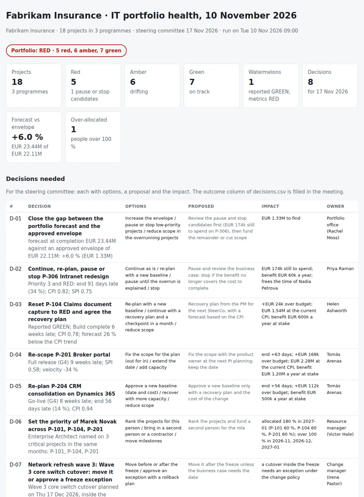

# IT Project Portfolio Health

The question before every steering committee: across the IT portfolio, which projects are healthy, which are drifting and which need a decision, and is the portfolio itself affordable and staffed? From the project list of the PPM tool, the milestones, the RAID log, the resource plan, the releases and the sprint history from Jira or Azure DevOps, it puts together:

- **Schedule:** the forecast end against the plan, milestones late or with no forecast, and gates passed without approval.
- **Cost:** EVM-light CPI and SPI from the % complete and the budget, the forecast at completion over budget, a forecast below what the CPI points to, and spending faster than time.
- **Status hygiene:** status not updated for weeks, "watermelon" projects that the PM reports GREEN while the metrics say RED, and RAID items overdue or with no owner.
- **Agile:** velocity falling sprint after sprint, and scope growing faster than it is delivered.
- **Resources:** people over 100 % across projects, one key person on several critical projects, and roles nobody fills.
- **Delivery:** releases planned inside a change freeze, and a change not approved with the go-live a few days away.
- **Value:** a benefit with no owner, and low-priority RED projects as pause or stop candidates; the portfolio forecast against the approved envelope.

Every project gets a computed **GREEN / AMBER / RED** with the reason, next to the RAG the PM reported, per programme and overall, and the steering committee gets the list of **decisions needed**, each with options, a proposal, the impact and an owner: **what is drifting, why, and what the committee has to decide.**

Python 3.10+, standard library only. It runs with fictional demo data out of the box. A read-only Python exporter for the Jira Cloud and Azure DevOps REST APIs writes the sprint history.

The steering committee is where the delivery side meets the operations side covered earlier in the series: [40-change-calendar-risk-review](https://github.com/inigogonzalezgarcia/40-change-calendar-risk-review) reviews the change calendar that a go-live has to fit into, and [46-problem-management-review](https://github.com/inigogonzalezgarcia/46-problem-management-review) tracks the fixes that often become the next project.



## Why

The monthly SteerCo pack is usually a set of slides where every PM fills in their own RAG. In a typical month with eighteen projects:

- a document capture project is reported GREEN while each euro spent buys 78 cents of the planned work and its build milestone is six weeks late;
- the Windows 11 rollout has not updated its status in five weeks;
- a network cutover is planned in the middle of the year-end change freeze;
- the go-live of the e-signature project is on Friday and its change is still waiting for the CAB;
- the enterprise architect is planned at 180 % across three critical projects, so all three will slip together;
- an automation project counts EUR 450k a year of benefit that nobody in the business owns;
- a low-priority intranet redesign is three months late and 25 % over budget, and nobody has asked whether it should go on;
- the broker portal keeps adding scope while its velocity falls;
- three RAID items in the telephony project are past their date with no owner;
- and the sum of the forecasts is 6 % over the envelope the board approved.

The data to see all of this exists, in the PPM tool, the RAID logs, the resource plan, the change records and Jira. The check reads them together, computes the RAG from the numbers against agreed thresholds, and turns the result into the decisions the committee has to take. The rules are in `settings.json` and `portfoliohealth/checks.py`.

## What it checks

| Dimension | Code | Finding | Severity |
|---|---|---|---|
| Schedule | SCH-SLIP | Forecast end later than planned, as % of the planned duration (10 / 20 %) | AMBER / RED |
| Schedule | SCH-MILESTONE, SCH-NOFORECAST | Milestone forecast late (14 / 30 days); baseline passed with no actual and no forecast | AMBER / RED, AMBER |
| Schedule | SCH-GATE | Gate passed with no approval recorded | RED |
| Schedule, cost | CST-SPI, CST-CPI | SPI and CPI below 0.95 / 0.85 | AMBER / RED |
| Cost | CST-EAC, CST-FORECAST | Forecast at completion over budget (5 / 10 %); reported forecast below budget / CPI | AMBER / RED |
| Cost | CST-BURN | Share of the budget spent more than 15 points ahead of the share of time elapsed | AMBER |
| Governance | GOV-STALE, GOV-WATERMELON | Status older than 21 days; reported GREEN with a computed RED | AMBER, RED |
| Governance | RAID-OVERDUE, RAID-UNOWNED | Open RAID items past their date; with no owner (RED with high-score items) | AMBER / RED |
| Agile | AGL-VELOCITY, AGL-SCOPE | Velocity of the last 3 sprints against the 3 before falling 15 / 30 %; scope growth 20 / 35 % | AMBER / RED |
| Resources | RES-OVER, RES-KEYPERSON, RES-UNSTAFFED | Person over 100 % in a month (RED from 150 %); one person on 2+ critical projects; role with nobody named | AMBER / RED, AMBER, AMBER |
| Delivery | DLV-FREEZE, DLV-CAB | Release inside a change freeze; change not approved with the go-live within 5 working days | AMBER, RED |
| Value | VAL-NOOWNER, VAL-STOP | Benefit with no owner; priority 3 and RED: pause or stop candidate | AMBER, decision |
| Portfolio | PRT-ENVELOPE | Sum of the forecasts over the approved envelope (RED beyond 5 %) | AMBER / RED |

The EVM is kept simple on purpose: the value of the work done is the budget × % complete (or story points done over total), the value planned by today is the budget × the share of the planned time elapsed, on a straight line. CPI = value of the work done / actual cost; SPI = value of the work done / value planned. The project RAG is the worst finding, per dimension and overall; resource findings count as AMBER at most for a project, because an over-allocated person is a portfolio problem. A programme is RED when a critical project is RED or a third of its projects are.

## Outputs

| File | What |
|---|---|
| `report.html` | Portfolio status and tiles, the decisions needed, a heat map of every project by dimension grouped by programme, a card per project with computed and reported RAG and the reason, the CPI and SPI scatter, the programmes, the resource load per person and month, and every finding |
| `steerco-pack.md` | One page for the committee: headlines, decisions needed with options, proposal, impact, owner and an outcome column, the red and amber projects with the reason, the portfolio against the envelope, what each owner brings, scope and evidence, minutes |
| `project-health.csv` | One row per project: reported and computed RAG, reason, dates, slip, progress, CPI, SPI, forecasts, benefit, last update, velocity, scope growth, RAID and the RAG per dimension |
| `findings.csv` | Every finding with severity, dimension, projects, detail, action, owner and due date |
| `resource-load.csv` | Allocation per person and month, with the projects, the critical ones and whether it is over 100 % |
| `decisions.csv` | The decisions for the SteerCo with options, proposal, impact, owner, date and an empty outcome column |
| `actions.csv` | Every finding as an action with a reference, owner, due date and done column |

## Try it

```bash
git clone https://github.com/inigogonzalezgarcia/49-it-project-portfolio-health.git
cd 49-it-project-portfolio-health
python -m portfoliohealth demo
```

Open `output/report.html` and `output/steerco-pack.md`.

### The demo data

The demo is a made-up insurer, Fabrikam Insurance, with three programmes (Claims Transformation, Digital Distribution and Core IT & Infrastructure) and 18 projects: waterfall, agile and two SAFe Agile Release Trains. The check runs on Tuesday 10 November 2026, a week before the steering committee of 17 November:

- 18 projects, 64 milestones and gates, 73 RAID items, 93 resource allocations for 17 people and one vacant role over three months, 7 releases with their change tickets, and 48 sprints of the agile projects.

Everything is fictional: people, projects, tickets and numbers. The problems are placed on purpose among projects that are on track:

- **Watermelon:** Claims document capture is reported GREEN with a CPI of 0.78, its build milestone six weeks late and a forecast that the CPI puts at EUR 1.54M against EUR 1.22M reported.
- **Stale status:** the Windows 11 and Intune rollout was last updated five weeks ago.
- **Change freeze:** the Wave 3 core switch cutover is planned on 17 December, inside the year-end freeze.
- **CAB:** the e-signature go-live is on Friday, three working days away, with its change still pending.
- **Key person:** the enterprise architect is planned at 180 % across three critical projects.
- **Benefit:** the RPA project counts EUR 450k a year with no benefit owner.
- **Stop candidate:** the priority-3 intranet redesign is 91 days late and 25 % over budget.
- **Agile:** the broker portal's scope grew 40 % while its velocity fell by a third.
- **RAID:** three items of the telephony project are overdue with no owner.
- **Envelope:** the portfolio forecast is 6.0 % over the approved envelope.

The result: **RED** overall; 5 projects red, 6 amber and 7 green; one watermelon; two programmes red and one amber; 8 decisions for the SteerCo.

## Use it with your own data

1. Export the sprint history of each agile project (read-only):
   ```bash
   export JIRA_EMAIL=you@contoso.com      # the API token is asked for, or read from JIRA_API_TOKEN
   python scripts/export_agile.py jira --site https://contoso.atlassian.net --board 42 --project-id P-201 \
       --points-field customfield_10016 --out data/sprints.csv
   python scripts/export_agile.py ado --org contoso --project "Broker Portal" --team "Broker Portal Team" \
       --project-id P-202 --out data/sprints.csv --append        # PAT from AZURE_DEVOPS_PAT, or asked for
   ```
   - Jira Cloud: the closed sprints of the board (`GET /rest/agile/1.0/board/{boardId}/sprint`) and their issues through the issue search (`POST /rest/api/3/search/jql`, paged with `nextPageToken`), signed in with your e-mail and an API token. The story points field id differs per site.
   - Azure DevOps: the team's past iterations (`GET .../_apis/work/teamsettings/iterations`), the work items of each through a WIQL query (`POST .../_apis/wit/wiql`) and their fields (`GET .../_apis/wit/workitems`), with a personal access token with the Work Items (Read) scope.
   - Only reads; the token stays in memory and is never written to disk.
2. Export `projects.csv` and `milestones.csv` from your PPM tool or portfolio sheet, `raid.csv` from the RAID logs, `resources.csv` from the resource plan (long or wide format) and, if you have them, `releases.csv` from the release calendar and the change records. Adjust `data/settings.json`: SteerCo date, envelope, thresholds, freeze windows and owners ([docs/data-format.md](docs/data-format.md) has every column and setting).
3. Build the outputs:
   ```bash
   python -m portfoliohealth review data/
   ```

[docs/steerco-runbook.md](docs/steerco-runbook.md) has the month before the SteerCo, what to send before it, the agenda, how to frame decisions (continue, re-plan, pause, stop), how to handle watermelon projects without blame, and how to follow up the actions.

The exports contain budgets, people's allocations and business cases. Keep them inside your organisation:

- real files at the top level (`projects*.csv`, `milestones*.csv`, `raid*.csv`, `resources*.csv`, `releases*.csv`, `sprints*.csv`, `settings.json`, `data/`, `downloads/`) and the `output/` folder are excluded from Git by `.gitignore`;
- only the fictional files in `sample_data/` are committed.

## Tests

```bash
pip install -r requirements-dev.txt
python -m pytest -q
```

GitHub Actions runs them on Python 3.10 and 3.12 on every push, then rebuilds the fictional sample data and the report screenshot from the simulator.

14 tests: loading PPM column names, amounts with separators, percentages, story points, RAID levels and wide resource plans; a project on plan; slip, late milestones, missing forecasts and gates without approval; CPI, SPI, forecast at completion, the forecast at the CPI and burn rate; stale status and RAID items overdue and unowned; velocity and scope growth; over-allocation, key people and unstaffed roles; releases in a freeze and changes not approved; watermelons, stop candidates, benefits without owner, the envelope and the decisions; programme and portfolio RAG; the exporter against mocked Jira and Azure DevOps responses; missing files; and the demo end to end (deterministic, all seven outputs, every planted finding).

## Next steps

- Run it a week before every SteerCo, and weekly for the RED projects.
- Read the projects and milestones straight from the PPM tool's API instead of an export.
- Keep the computed RAG of every month to show the trend per project and how early each RED was visible.
- Add the PI objectives of each Agile Release Train (planned against achieved business value) as one more agile check.
- Publish the pack to Confluence for the members before the meeting.

## Background

Built from my work planning and governing IT change:

- portfolio management of initiatives; Agile and Scrum, acting as Scrum Master and Product Owner; SAFe and PI Planning; Kanban and visual management;
- technical feasibility assessment of requests and projects, estimation of cost, resources and timelines, and business cases with ROI and measurable benefits;
- workshops with the business, functional requirements, user stories and acceptance criteria;
- release management (planning, testing, rollback, post-release validation), change advisory board participation and go-live and service acceptance reviews;
- preparing and tracking the IT budget, negotiating vendor contracts, and process dashboards and KPIs as process owner for incident, change and problem;
- Jira, Confluence, Jira Service Management and Azure DevOps; Python and PowerShell.

Written from scratch with fictional data; no employer data, systems or exports are used.

## Customisation and contact

Want this adapted to your environment? For example:

- your PPM tool's export or API as the source of projects and milestones;
- your thresholds, priorities, programmes and approval gates;
- your Jira or Azure DevOps boards and story point fields;
- the pack in the format of your steering committee.

Get in touch:

- Website (contact form): [inigogonzalezgarcia.github.io](https://inigogonzalezgarcia.github.io/about.html#contacto)
- LinkedIn: [linkedin.com/in/igonzalez93](https://www.linkedin.com/in/igonzalez93)

## License

MIT
